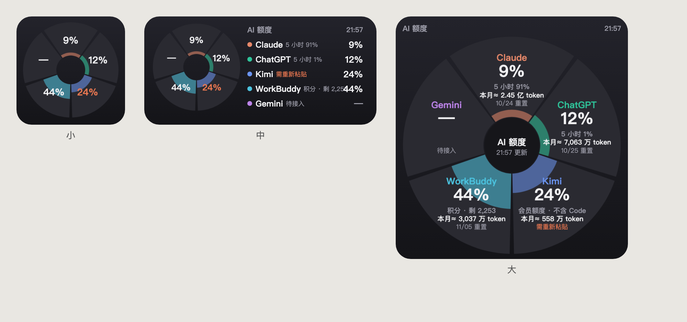

# AI 额度 Pizza 看板

把 **Claude、ChatGPT、Kimi、WorkBuddy、Gemini** 五个 AI 账号的**官方额度使用率**（含所有设备）汇总成一张「5 块披萨」图，在 Mac 网页和 iPhone 桌面小组件上一眼看清哪个快被限速了。



- 每块披萨：账号 · 会员等级 / 大号主额度 % / 小字副额度 / 本月消耗 token / 重置倒计时
- 从圆心向外按用量填色：≥70% 变黄，≥90% 变红
- Mac 上零依赖（只用系统自带的 Python 3）；手机只需免费的 Scriptable

## 工作原理

```
本机日志 + 本机登录 ─┐
Chrome 扩展（Gemini/Kimi）─┼─► server.py（Mac，:8787）─► 网页看板
设置页粘贴（WorkBuddy）─┘            │
                                   └─ 每 5 分钟推送「只含数字」的 JSON ─► GitHub 私密 Gist ─► iPhone 小组件
```

| 账号 | 主额度（大号） | 副额度（小字） | 数据从哪来 |
|------|---------------|---------------|-----------|
| Claude | 5 小时 % | 本周 % | 官方额度接口，用本机 Claude Code 的登录 |
| ChatGPT | 5 小时 % | 本周 % | 官方额度接口，用本机 Codex 的登录 |
| Gemini | 5 小时 % | 本周 % | Chrome 扩展读取 gemini.google.com/usage |
| Kimi | 会员总用量 %（含 Code） | Code 本周 % | Chrome 扩展读取 kimi.com「我的订阅」页 |
| WorkBuddy | 积分使用率 %（套餐 + 同周期赠送包） | 剩余积分 | 设置页粘贴一次网页请求 |

「本月消耗 token」= 输入 + 缓存写入 + 输出（不计缓存读取），来自本机日志；WorkBuddy 按积分 × 实测每积分 token 数估算。

## 环境要求

- macOS（已在 Apple Silicon 上测试），系统自带 `python3`（没有就运行 `xcode-select --install`）
- 需要显示哪些账号，就在这台 Mac 上用过对应工具：Claude Code、Codex、Kimi 桌面版、WorkBuddy、Chrome（登录 Gemini 与 Kimi）
- 手机小组件：iPhone + [Scriptable](https://apps.apple.com/app/scriptable/id1405459188)（免费）+ GitHub 账号与 [GitHub CLI](https://cli.github.com/)

## 安装

> ⚠️ 不要放在「文稿」「桌面」「下载」里：macOS 隐私保护会阻止开机自启的服务读取这些文件夹。

```bash
git clone https://github.com/jameszhangziyan/ai-quota-dashboard.git ~/ai-quota-dashboard
cd ~/ai-quota-dashboard
./install.sh
```

安装脚本会：生成访问密钥 → 生成 Chrome 扩展配置 → 设置开机自启（LaunchAgent）→ 打印后续步骤。

### 后续步骤

1. **打开看板**：脚本最后会打印 `http://127.0.0.1:8787/?k=<密钥>`。
2. **Gemini / Kimi**：`chrome://extensions` → 打开「开发者模式」→「加载已解压的扩展程序」→ 选 `token_dashboard/chrome_extension`。Chrome 里保持登录 gemini.google.com 和 kimi.com，扩展每 15 分钟读取一次用量。
3. **WorkBuddy**：打开设置页 `http://127.0.0.1:8787/settings?k=<密钥>`，在 workbuddy.cn 的「套餐用量」页按提示复制 `get-user-resource` 请求并粘贴。网页登录过期后会提示重新粘贴。
4. **iPhone 小组件**：
   ```bash
   brew install gh && gh auth login --web --scopes gist   # 首次
   cd ~/ai-quota-dashboard/token_dashboard && python3 make_loader.py
   ```
   把生成的 `AI额度.js` 隔空投送到 iPhone，用 Scriptable 打开 → 桌面添加 Scriptable 小组件（中号或大号）→ 编辑小组件，Script 选「AI额度」。加载器每次刷新都会从 Gist 取最新代码，以后更新界面无需重装。

## 安全说明

- **Gist 只包含展示用的数字**（百分比、重置时间、token 数、提示文字），不含任何令牌或 Cookie。私密 Gist 是「不公开列出」，知道链接的人能看到这些数字。
- **Claude / ChatGPT**：只读取本机已有登录令牌调用官方额度接口，不保存、不刷新（避免把原工具登出）。
- **Chrome 扩展**只读取页面上显示的用量，不读取任何令牌或 Cookie；只能访问 gemini.google.com、kimi.com 和本机看板。
- **WorkBuddy**：粘贴的请求（含登录信息）只保存在本机 `.manual_auth.json`（权限 600），只发回原官方地址；设置页只能在本机打开。
- 访问密钥、登录信息、手机加载器都已列入 `.gitignore`，不会被提交。
- 不需要、也不建议给 Python「完全磁盘访问权限」。

## 常用命令

```bash
launchctl kickstart -k gui/$(id -u)/com.$(whoami).ai-quota-dashboard   # 重启服务
tail -f ~/Library/Logs/ai-quota-dashboard.log                           # 看日志
./uninstall.sh                                                          # 停止并移除开机自启
```

| 看板提示 | 处理 |
|---------|------|
| 需打开 Claude Code / Codex | 打开一次对应工具，登录会自动续期 |
| 需重新粘贴 | WorkBuddy 网页登录过期，去设置页重新粘贴 |
| 需打开 Chrome | 扩展 3 小时没上报：确认 Chrome 在运行、扩展已启用 |
| 小组件「离线」 | 显示的是上次数据：检查 Mac 是否开机、服务是否运行、gh 是否登录 |

## 目录结构

```
install.sh / uninstall.sh       安装与卸载
token_dashboard/
  server.py                     HTTP 服务、日志解析、Gist 推送线程
  quota.py                      各账号额度抓取 + 统一卡片结构 build_card()
  manual_auth.py                解析「Copy as cURL」并重放（WorkBuddy）
  ext_bridge.py                 接收 Chrome 扩展上报
  gist_push.py                  推送 ai-quota.json 与 widget.js 到 Gist
  index.html / settings.html    Pizza 看板 / 登录设置页
  TokenWidget.js                Scriptable 小组件主体（通过 Gist 分发）
  loader.template.js            手机加载器模板；make_loader.py 生成 AI额度.js
  chrome_extension/             Chrome 扩展（MV3）
docs/                           截图
```

## 已知限制

- 各家额度接口和页面都是非公开的，可能随时变化；变化时对应那块会显示提示，需要更新解析代码。
- Kimi 网页登录令牌约 20 分钟过期，所以由 Chrome 扩展读页面文字，而不是粘贴请求。
- 本月 token 只统计这台 Mac 的本地日志；额度百分比才是含所有设备的账号级数据。

## 许可证

MIT
